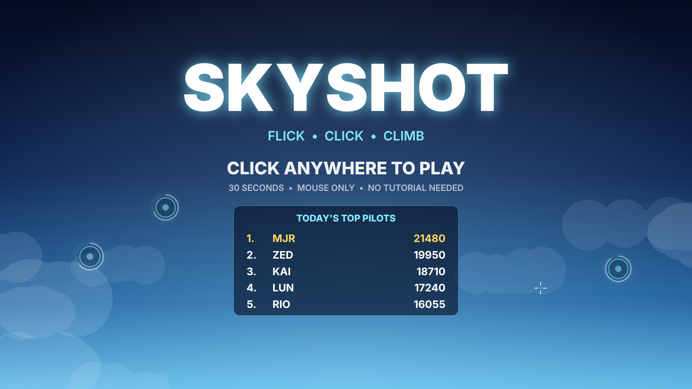
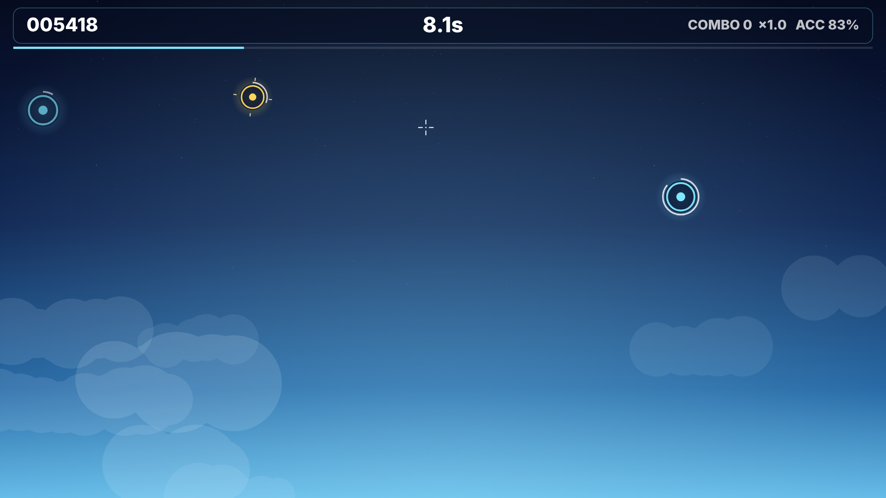
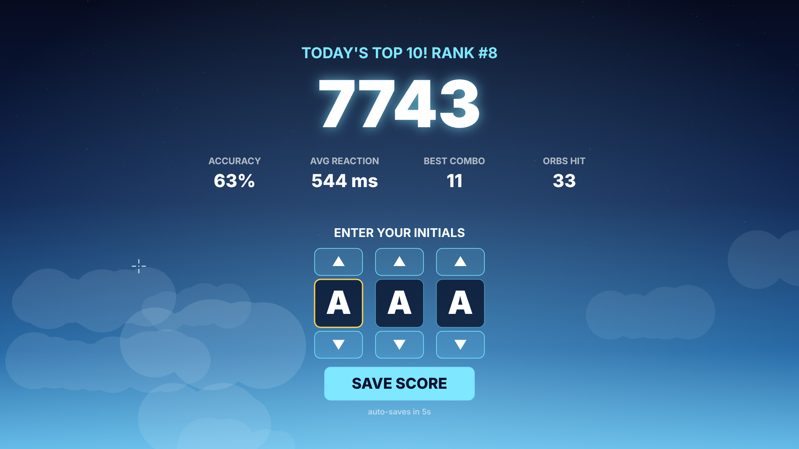
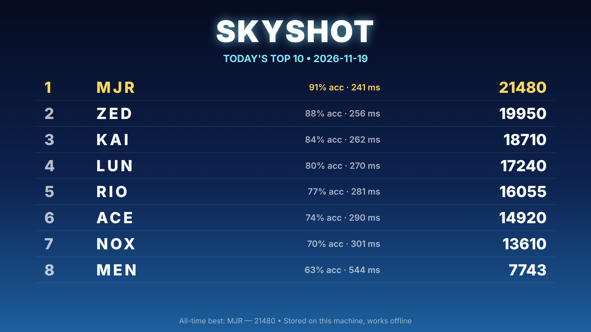

# SKYSHOT: a flick-and-click aim trainer for event booths

**Cloud9 x JetBrains: Sky's The Limit Hackathon 2026, Category 3: Event Mini Game**

SKYSHOT is a 45-second aim trainer built for a live booth. Glowing orbs appear across a twilight sky. Players click them before they fade. Gold orbs are worth triple, and a clean streak builds a multiplier up to ×4. The game is mouse-only and needs no tutorial: the attract screen says "click anywhere to play", and that is the whole instruction set.



| Gameplay | Results + initials | Leaderboard monitor |
|---|---|---|
|  |  |  |

*Screenshots use seeded demo scores.*

## Why it fits a booth

| Booth need | What SKYSHOT does |
|---|---|
| Fast sessions | 3s countdown + 45s round + results ≈ 1.5 minutes per player |
| Zero learning curve | Mouse only. Click the orb. Nothing else to learn. |
| Replayability | Combo multiplier, gold orbs, rising difficulty, and a public daily top 10 |
| A competitive skill | Trains flick aim and reaction time, and shows average reaction in ms after every run |
| Clean reset between players | Every round builds a fresh state object; the results screen returns itself to the attract screen |
| Stays responsive all day | One animation loop, fixed-size effect pools, input handlers attached once. Soak-tested (see below) |
| No Wi-Fi | Scores live in `localStorage` on the booth machine. No network calls of any kind. |
| Second monitor | `leaderboard.html` shows today's top 10 live in a separate window |

## Run it

No build step and no dependencies.

```bash
git clone <this-repo-url> skyshot && cd skyshot
python3 -m http.server 8000        # any static server works, and it runs fully offline
```

- Game: open `http://localhost:8000/` and press **F** for fullscreen
- Leaderboard monitor: open `http://localhost:8000/leaderboard.html` on the second screen (or press **L** in the game)

Opening `index.html` straight from disk also works in Chrome. The local server is recommended because it keeps the monitor's live sync instant across windows.

**Live demo:** `https://<your-github-user>.github.io/skyshot/` (GitHub Pages, static)

## Booth operator controls

| Key | Action |
|---|---|
| `F` | Toggle fullscreen |
| `L` | Open the leaderboard monitor window |
| `M` | Mute or unmute |
| `Esc` | Abort the current round and return to the attract screen |
| `Ctrl+Shift+E` | Export every stored score to CSV (all days) |
| `Ctrl+Shift+X` (twice within 3s) | Clear today's leaderboard |

URL options for staff: `?round=60` (round length in seconds), `?idle=25` (seconds before initials auto-save), `?return=9` (seconds before returning to the attract screen).

## How a session flows

1. **Attract**: title, today's top 5, demo orbs. Any click starts. A 1.2s input guard stops the last player's stray click from starting a new round.
2. **Countdown**: 3, 2, 1, with a one-line rule: "Click the orbs before they fade. Gold ones are worth triple."
3. **Play (45s)**: difficulty ramps on a smoothstep curve. Spawn rate rises, orbs shrink and live shorter, up to 5 at once, and moving orbs appear in the second half to force flicks. Orbs never spawn under the cursor.
4. **Results**: score, accuracy, average reaction time, best combo. A top-10 run gets a 3-letter initials picker (click ▲/▼ or use arrow keys), which auto-saves after 25s if the player walks away. Every run is logged for the CSV, top 10 or not.
5. **Back to attract** automatically, or **PLAY AGAIN**.

### Scoring

`points = (100 + speed bonus up to 100) × combo multiplier × (3 if gold)`

The multiplier rises ×0.5 every 5 consecutive hits, up to ×4. A missed click or an orb that fades resets the combo.

## Tested: reset and responsiveness

`tests/soak_test.py` drives a real Chromium browser through back-to-back rounds with all outside network requests blocked. A second window runs the leaderboard monitor. Every round it checks that the score, counters, combo, targets and previous result all reset. It exercises all three exit paths (save, idle auto-save, play again) and confirms the monitor updates.

Results from runs in this repo (`tests/soak_report_*.json`):

| Run | Rounds | Result | Frame time p95 | Notes |
|---|---|---|---|---|
| 20 × 8s rounds | 20 | PASS | 16.8 ms (60 fps) | JS heap 2.34 MB → 2.35 MB after 20 players; 20/20 runs stored |
| 3 × 45s full rounds | 3 | PASS | 16.7 ms | Full late-game load (5 orbs, moving targets) |
| 6 × 6s regression | 6 | PASS | 16.8 ms | Rerun after the final fixes |

Rerun it yourself:

```bash
pip install playwright && playwright install chromium
python tests/soak_test.py --rounds 20 --round-seconds 8
```

Caveat: these runs used headless Chromium on a Linux machine. Frame timing on the actual booth PC and monitor should be confirmed on site with the same script (add `--headed` to watch).

## Project structure

```
index.html          game shell
leaderboard.html    second-monitor leaderboard (live, offline)
js/game.js          game loop, states, difficulty, scoring, rendering, input
js/store.js         offline leaderboard store (localStorage + BroadcastChannel)
js/audio.js         synthesized sound effects (Web Audio, no audio files)
css/style.css       layout for both screens
tests/soak_test.py  automated booth soak test (Playwright)
docs/               methodology, media
```

## Original work

All names, art and sound are original. The art is drawn by code on a canvas, and the sound is synthesized at runtime, so the repo holds no third-party assets. The game is a genre homage to aim trainers and borrows nothing from any Riot Games title.

## License

MIT. See [LICENSE](LICENSE).
